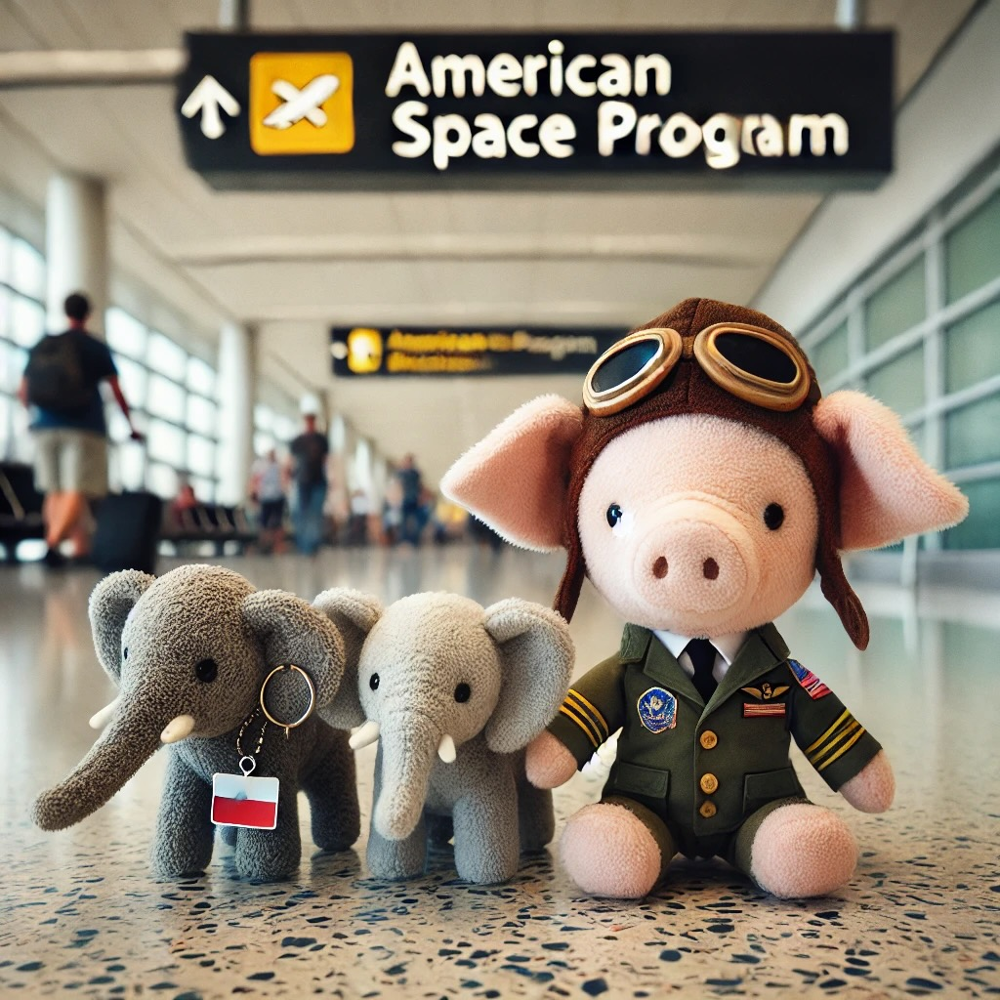
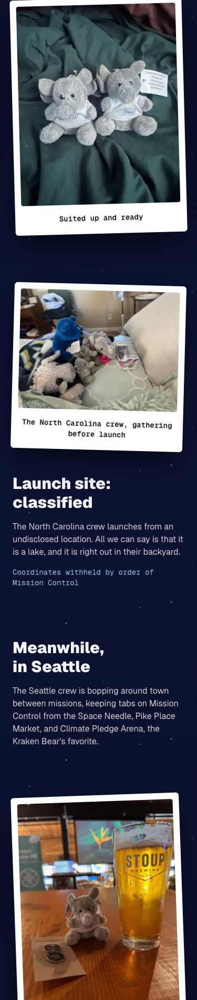
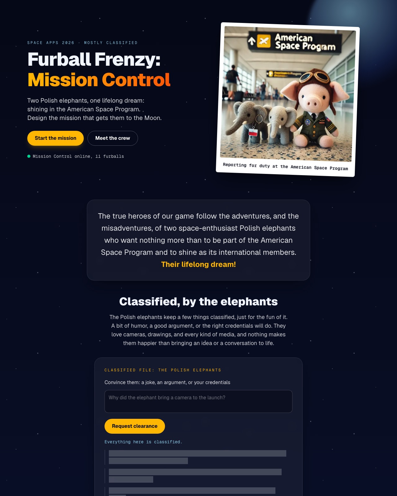

# 🐘 Furball Frenzy: Mission Control

<p align="center"></p>

A web game for the **2026 NASA Space Apps Challenge**, the *Space Mission Design Game*
challenge, built by a team of one with a crew of plush explorers.

**The true heroes of the game are two space-loving Polish elephants** who want nothing more
than to be part of the American Space Program and to shine as its international members.
Their lifelong dream. Plan a mission from launch to the Moon or Mars, balance mass, power,
budget, data, and communications, and see how every choice shapes the result.

- Team page: <https://www.spaceappschallenge.org/2026/find-a-team/furball-frenzy-mission-control/>
- Challenge: <https://www.spaceappschallenge.org/2026/challenges/space-mission-design-game/>
- Game plan: [docs/game-plan.md](docs/game-plan.md)

## See it

| Phone (375), top of page, full page in docs/screenshots | Desktop (1280) |
| --- | --- |
|  |  |

Animated GIFs of the game loop go here as the app evolves. Keep the README's visuals current with every visual change.

## Stack

| Part | Tech |
| --- | --- |
| `apps/web` | Next.js, TypeScript, Tailwind, pnpm |
| `apps/api` | FastAPI, uv |
| `infra` | Docker Compose, deployable to an Oracle Cloud VM |

## Run it

Needs Docker.

```bash
npr start      # web on http://localhost:3000, api on http://localhost:8000, detached
npr stop       # stop
npr build      # fresh rebuild, no cache
npr clean      # remove containers and the images built here
npr logs       # tail logs
```

`npr` is `npm run`, the scripts wrap the Makefile, so `make up` (foreground), `make down`, and the rest work too.

Native dev:

```bash
cd apps/api && uv sync --extra dev && uv run uvicorn app.main:app --reload
cd apps/web && pnpm install && pnpm dev   # forwards /api/* to localhost:8000
```

Tests and lint: `make test`, `make lint`.

## Status

A placeholder landing page introduces the game and the crew, and proves the web app and the
FastAPI backend talk to each other. The game itself is next, see the game plan.

## Credits

- Photos of the furballs by Rob Brennan.
- The lunar rover is inspired by the PLAYMOBIL ESA Starter Pack Space Mission (71734).
- Mission design references from NASA, listed on the challenge's Resources tab.

Built over the Space Apps weekend in North Carolina, with the Charlotte, NC local event.
Released under the [MIT License](LICENSE).
