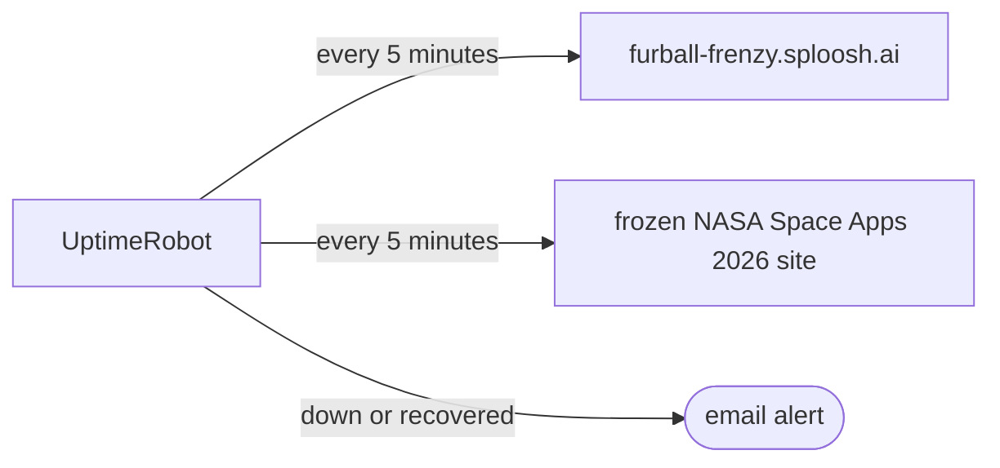

# Monitoring and analytics

**Last updated:** 2026-11-25

## Uptime

UptimeRobot, HTTP checks every 5 minutes, email alerts. Monitored:

- `https://furball-frenzy.sploosh.ai/`
- `https://furball-frenzy-nasa-space-apps-challenge-2026.sploosh.ai/`

## Analytics

None. PostHog was removed on 2026-11-25. If analytics is added again, record the events here and what is
never collected.
